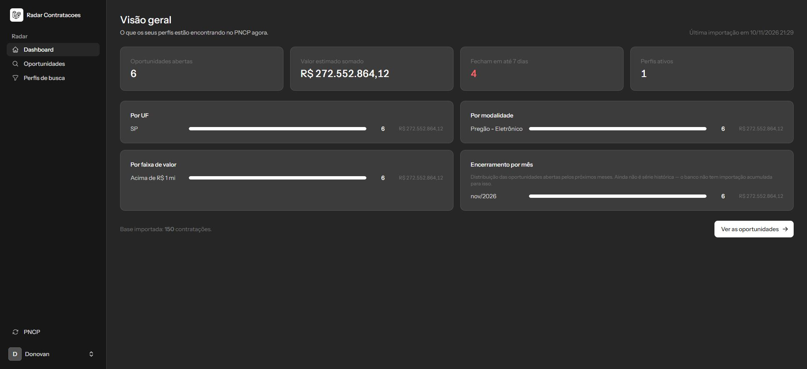
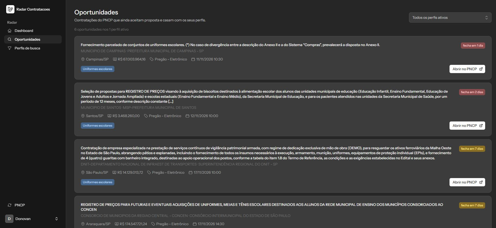

# Radar de Contratações

Monitoramento de contratações públicas brasileiras. O usuário cadastra perfis de busca
(palavra-chave, UF, modalidade, faixa de valor), um comando importa as contratações abertas
do **PNCP** e o sistema mostra só o que casa com esses perfis — com link direto para o edital.


*Dashboard: o que os seus perfis estão encontrando no PNCP agora.*


*Oportunidades: contratações que ainda aceitam proposta, ordenadas pelo prazo.*

> **Estado: v0.1.** O que está nesta página foi implementado e testado. O que não está,
> aparece na seção [O que ainda não existe](#o-que-ainda-não-existe) — sem promessa.

## O que está pronto

| Funcionalidade | Como funciona |
|---|---|
| Contas | login, cadastro e verificação de e-mail (starter kit oficial do Laravel + Fortify) |
| Perfis de busca | CRUD com palavras-chave, palavras de exclusão, UFs, modalidades e faixa de valor |
| Importação | `php artisan radar:importar` busca `/v1/contratacoes/proposta` e faz upsert por `numero_controle_pncp` |
| Motor de match | cruza contratação × perfil com sinônimos, exclusão e normalização de acento |
| Listagem | oportunidades abertas ordenadas pelo prazo, com órgão, município, valor e link oficial |
| Dashboard | totais e valor somado, por UF, modalidade, faixa de valor e mês de encerramento |

Rodar a importação duas vezes seguidas **não duplica** nada: a chave de deduplicação é o
`numeroControlePNCP` que o próprio PNCP gera.

## O que ainda não existe

- **Agendamento** da importação (`schedule:run` diário)
- **Alerta por e-mail ou Telegram** quando aparece oportunidade nova
- **Histórico** de oportunidade vista / salva / descartada
- **Consulta de CNPJ na BrasilAPI** (dados do fornecedor)
- **Deploy** em URL pública
- **Série histórica** de verdade no dashboard. O gráfico "encerramento por mês" é a
  distribuição das oportunidades *abertas* pelos próximos meses, não a evolução das
  importações ao longo do tempo — para isso o banco precisa acumular histórico.

## Stack

- **PHP 8.5** · **Laravel 13** · **Livewire 4** (componentes single-file) · **Flux UI**
- **PostgreSQL 16** — escolhido pelas consultas agregadas do dashboard futuro
- **Pest 5** para testes, **PHPStan** (Larastan) e **Pint** para qualidade
- **Sem Docker**: banco e aplicação rodam nativos. `php artisan serve` + `npm run dev`

## Como rodar

Pré-requisitos: PHP 8.3+, Composer, Node 20+, PostgreSQL 14+.

```bash
# 1. dependências
composer install
npm install

# 2. ambiente
cp .env.example .env
php artisan key:generate

# 3. banco (crie antes, vazio)
createdb radar_contratacoes
# ajuste DB_DATABASE, DB_USERNAME e DB_PASSWORD no .env

php artisan migrate
npm run dev          # terminal 1
php artisan serve    # terminal 2 → http://localhost:8000
```

Crie uma conta em `/register`, cadastre um perfil em `/perfis` e importe dados:

```bash
php artisan radar:importar --uf=SP --modalidade=6 --paginas=3
```

### Um detalhe de ambiente no Windows

O PHP para Windows não vem com CA bundle configurado, e sem ele **qualquer requisição HTTPS
via cURL falha** (`SSL certificate problem`). Baixe `cacert.pem` de <https://curl.se/ca/cacert.pem>
e aponte no `php.ini`:

```ini
curl.cainfo = "C:\php-8.5\cacert.pem"
openssl.cafile = "C:\php-8.5\cacert.pem"
```

## Comandos

```bash
php artisan radar:importar              # importa com os padrões (30 dias à frente, 20 páginas)
php artisan radar:importar --uf=SP      # restringe a uma UF
php artisan radar:importar --modalidade=6 --dias=15 --paginas=5

php artisan test                        # suíte
vendor/bin/pint                         # formatação
vendor/bin/phpstan analyse              # análise estática
```

## Como o match funciona

**Etapa 1 — em SQL.** UF, modalidade, faixa de valor e prazo de proposta. O banco descarta o
grosso antes de qualquer coisa chegar ao PHP. Contratação sem valor informado (`0`) não é
descartada por faixa: filtrar esconderia oportunidade legítima.

**Etapa 2 — em PHP.** Palavras-chave, sinônimos e exclusões. Comparar texto em SQL exigiria
`unaccent` + `ILIKE` por termo; em PHP a regra fica legível e testável:

- texto normalizado (minúsculas, sem acento)
- o termo precisa começar em uma palavra — `obra` não casa com `manobra`
- plural funciona por prefixo — `uniforme` casa com `uniformes`
- sinônimos vêm de `config/radar.php` e valem nos dois sentidos
- qualquer palavra de exclusão presente descarta a contratação

Limite conhecido: a etapa 2 processa no máximo 2.000 candidatas por perfil. Quando o volume
crescer, o match precisa ser materializado numa tabela — que é exatamente o que o sistema de
alerta vai exigir.

## Fonte dos dados

- **PNCP** — <https://pncp.gov.br/api/consulta> (público, sem chave). Swagger:
  <https://pncp.gov.br/api/consulta/swagger-ui/index.html>
- Todos os endpoints usados foram verificados contra a API real. Descobertas que a
  documentação não deixa óbvias estão documentadas no código:
  `dataFinal` é o **teto** do encerramento de propostas, `tamanhoPagina` aceita no máximo 50
  e página além do fim devolve **HTTP 204**, não lista vazia.
- As modalidades em `config/radar.php` só listam os códigos cujo nome foi confirmado na API.
  Faltar é melhor do que exibir filtro com nome inventado.

Nenhum dado pessoal, nenhuma credencial e nenhum código de sistema privado está neste
repositório.

## Testes

```bash
php artisan test
# 101 testes, 271 asserções
```

O client do PNCP é testado contra uma resposta **real** da API, guardada em
`tests/Fixtures/pncp-contratacoes-proposta.json`, reduzida a três registros. O motor de match
tem teste para cada regra: sinônimo, plural, radical, exclusão, faixa de valor e prazo.

## Licença

MIT.
